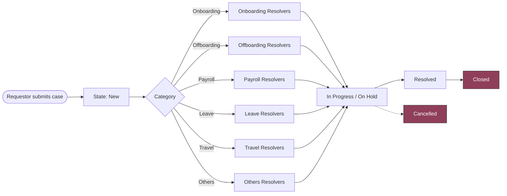

# HR Case Management

**A custom scoped ServiceNow application for raising, routing and resolving HR requests — built without the HRSD module.**

[Overview](#overview) •
[Features](#features) •
[Case Lifecycle](#case-lifecycle) •
[Data Model](#data-model) •
[Security](#security-model) •
[Routing](#automatic-routing) •
[Roadmap](#roadmap)

---

## Overview

A mid-sized company needed a way to manage HR requests without paying for the full ServiceNow HRSD
module, most of which it would never use. **HR Case Management** is a lean, self-contained
alternative: employees raise a request, the platform routes it to the right resolver group, and
HR admins work it through to resolution.

| | |
|---|---|
| **Platform** | ServiceNow Personal Developer Instance (Zurich release) |
| **Application type** | Scoped custom application |
| **Scope** | `x_2273364_hr_cas_0` |
| **Core table** | `x_2273364_hr_cas_0_hr_case` (extends `task`) |
| **Case numbers** | `HRC0000001` (prefix `HRC`, 7 digits) |
| **Roles** | `user` (requestor) and `admin` (resolver) |

## Features

- **Scoped and isolated** — the whole app lives in its own application scope with its own roles, groups and ACLs.
- **Task-based case table** — HR Case extends `task`, inheriting assignment, state and journal fields.
- **Auto-numbered cases** — every case gets a read-only `HRC#######` number.
- **Cascading categories** — Subcategory options depend on the chosen Category.
- **Smart form behaviour** — Department and Email fill in from the Caller; picking *Incident* warns the user to use the Incident module and hides Subcategory.
- **Role-based views** — requestors see a short *Create* form; admins see the full form.
- **Automatic routing** — a new case is assigned to the matching resolver group by Category.
- **Server-side security** — field-level and record-level ACLs, not just hidden fields.
- **Locked closed cases** — users cannot update a case once it is *Closed* or *Cancelled*.

## Case Lifecycle

### States

| State | Value | Who can set it |
|---|---|---|
| New | 1 | Default on creation |
| In Progress | 2 | Admin |
| On Hold | -5 | Admin |
| Resolved | 6 | Admin |
| Closed | 3 | Admin |
| Cancelled | 4 | Admin |

## Data Model

### Categories and subcategories

| Category | Subcategories |
|---|---|
| **Onboarding** | Laptop · Mobile · Desktop · ODC Access |
| **Offboarding** | Submit ID · Laptop · Desktop · Revoke Access |
| **Payroll** | Payroll Query · Payroll Issue |
| **Leave** | Leave Adjustment · Leave Query · Maternity Leave · Paternity Leave |
| **Travel** | Onsite · Offshore · Relocation · Holiday |
| **Others** | Others |
| **Incident** | *(No subcategory — the form tells the user to use the Incident module.)* |

### Key fields

| Field | Type | Behaviour |
|---|---|---|
| Number | Auto-number | Prefix `HRC`, read-only on every form |
| State | Choice | Six values; read-only for users, editable for admins |
| Caller | Reference → User | Defaults to the logged-in user |
| Department | Reference → Department | Filled in from the Caller's profile |
| Email | String | Filled in from the Caller's profile |
| Category | Choice | Mandatory |
| Subcategory | Choice | Depends on Category; mandatory except for Incident |
| Short description / Description | String | Inherited from `task` |

## Security Model

| Capability | `user` | `admin` |
|---|:---:|:---:|
| See **Create New** and **All** modules | ✅ | ✅ |
| See every other module | ❌ | ✅ |
| Create a case | ✅ | ✅ |
| Update a case | ✅ | ✅ |
| Change **State** and **Assigned to** | ❌ | ✅ |
| Update a *Closed* or *Cancelled* case | ❌ | ✅ |
| Delete a case | ❌ | ✅ |

`admin` contains the `user` role, so an admin inherits everything a requestor can do.

**How it is enforced**

- Table-level ACLs for create, read, write and delete.
- Field-level ACLs on Short description, Description, State and Assigned to.
- A scripted `write` ACL (*Deny Unless*) that blocks updates when State is Closed or Cancelled.
- A View Rule that gives requestors the *Create* view and leaves admins on the full form.

> Modules and form views only shape the experience. Access is enforced by ACLs on the server.

## Automatic Routing

Assignment rules set the **Assignment group** from the **Category** when a case is created.

| Category | Assignment group |
|---|---|
| Onboarding | Onboarding Resolvers Group |
| Offboarding | Offboarding Resolvers Group |
| Payroll | Payroll Resolvers Group |
| Leave | Leave Resolvers Group |
| Travel | Travel Resolvers Group |
| Others | Others Resolvers Group |

Each resolver group carries the `admin` role, so every member can work the cases routed to it.

## Configuration Inventory

| Type | Name | Purpose |
|---|---|---|
| Table | HR Case | Stores HR requests (extends `task`) |
| UI Policy | HR Case – Number read-only | Locks the Number field on the form |
| Client Script | HR Case – Populate Department and Email | Copies Department and Email from the Caller |
| Client Script | HR Case – Category change handler | Incident warning, Subcategory visibility and mandatory rule |
| View Rule | HR Case – Create view for users | Shows requestors the short *Create* form |
| Assignment Rules | HR Case – *(six, one per category)* | Route cases to the matching resolver group |
| ACL | Table and field ACLs | Role-based create / read / write / delete |
| ACL (scripted) | Closed / Cancelled update lock | Blocks user updates on closed cases |
| Groups | Six Resolvers Groups | Fulfilment teams, each holding the `admin` role |

## Roadmap

**Phase 1**

- [x] Scoped application and branding
- [x] Roles and role-based module access
- [x] HR Case table with auto-numbering
- [x] Fields, cascading choices and form behaviour
- [x] Role-based form and list views
- [x] Resolver groups
- [x] Assignment rules
- [x] ACLs and security
- [ ] Data import with transform map
- [ ] Knowledge bases and articles
- [ ] Service Catalog record producer
- [ ] Dashboard and reports
- [ ] Closed / Cancelled notification
- [ ] Promotion to a UAT instance

**Planned for Phase 2:** SLA and escalation, approvals, Service Portal intake, integrations, ATF, Flow Designer.

## Repository

This repository holds the application source exported from ServiceNow Studio.
Changes are first captured in update sets on the development instance and committed here.

## Author

Built as a ServiceNow real-time project assignment by **Your Name**.

---

Built on ServiceNow · Scoped · Role-based · No HRSD required

